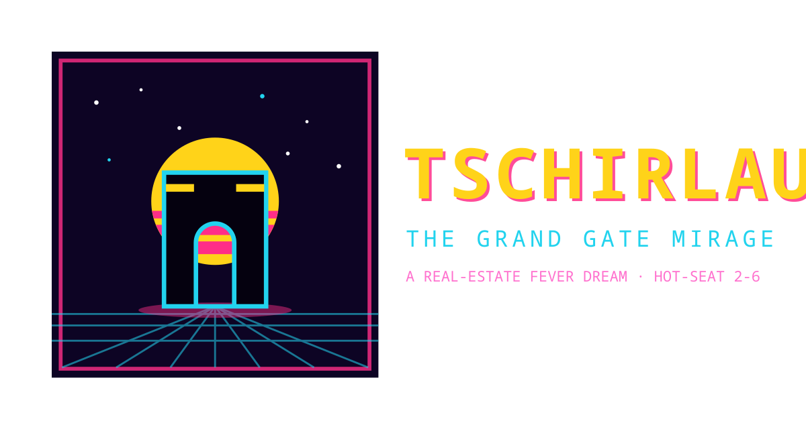

# Tschirlau: The Grand Gate Mirage



**The city is booming. The gates are rising. The debt is compounding. And the crash is inevitable.**

Tschirlau: The Grand Gate Mirage is a satirical, synthwave-styled economic strategy board game about speculative real estate, financial engineering, and the collective delusion that property prices can rise forever.

Compete against 1–5 other players in a fictional city where land is leverage, unfinished towers are instruments of hype, and every ambitious construction project brings the economy one step closer to collapse. Buy plots, build gates and towers, manipulate market sentiment, negotiate joint ventures, mortgage your assets, and borrow from a bank that always seems to come out ahead.

**Your objective is simple: survive the bubble and finish richer than your rivals.**

The catch? You are all helping inflate the same bubble.

**[Play Tschirlau online](https://richie-rich90454.github.io/tschirlau-game/)** · **[View source code](https://github.com/richie-rich90454/tschirlau-game)**

---

## At a glance

| | |
|---|---|
| Genre | Economic strategy, satirical board game |
| Players | 2–6, local hot-seat multiplayer |
| Platform | Web browser; offline-capable static build |
| Board | 40 spaces, 20 plots, 4 zones |
| Duration | Up to 20 rounds |
| Rendering | Phaser 4 |
| Language | TypeScript |
| Toolchain | Bun 1.3.14 |
| Audio | Procedural music and sound effects via Web Audio API |
| Deployment | Static hosting, including GitHub Pages |

## Features

### An economy built to collapse

- **Speculative real estate:** Acquire plots across four zones, each with hidden quality that makes investment a gamble.
- **Construction and development:** Raise structures through four construction levels, balancing the cost of development against the potential return.
- **Leverage and liabilities:** Mortgage property, take bank loans, repay debt, and manage interest, upkeep, and construction expenses.
- **Market manipulation:** Build hype around unfinished structures, influence the bubble, and decide when to prioritize growth over financial stability.
- **Negotiation and cooperation:** Participate in bids, negotiate deals, and enter joint ventures in which cooperation is not always the rational choice.
- **Bankruptcy and net worth:** Manage liquidity, liabilities, and assets while competing to finish the game in the strongest financial position.

### A complete boom-and-bust cycle

The game unfolds through three economic phases:

1. **BOOM — Rounds 1–10:** Pursue growth, acquire land, build aggressively, and inflate market expectations.
2. **COOLING — Rounds 11–15:** Reassess your investments as the economic environment changes.
3. **CRASH — From Round 16:** Face a randomly selected hard, medium, or soft crash.

The bubble can burst early if speculation pushes the market too far. Surviving the initial collapse is not necessarily the end of the danger, either: the game includes a second-death ending.

The final objective is to survive the economic cycle and maximize your net worth by the end of round 20.

### Synthwave arcade presentation

- Neon-styled board and interface.
- Animated title screen and in-game presentation.
- Screen shake, particles, dice animations, and event banners.
- CRT scanline effects.
- An original procedural soundtrack featuring two 8-bit music loops and synthesized sound effects.

Music and sound effects are generated at runtime with the Web Audio API rather than loaded from separate audio files.

### Offline-first and self-contained

- Self-hosted fonts and local assets.
- No external runtime services or network dependencies.
- Static production build in `dist/`.
- Optional single-executable packaging with an embedded page, JavaScript bundle, and fonts.
- Local development and production preview without a separate application server installation.

The result is a game that can be hosted as a static website or packaged for local use.

---

## Getting started

### Prerequisites

Install [Bun](https://bun.com/) 1.3.14.

### Run locally

```bash
git clone https://github.com/richie-rich90454/tschirlau-game.git
cd tschirlau-game
bun install
bun dev
```

Open [http://localhost:3000/](http://localhost:3000/) in your browser and select a player count.

### Build for production

```bash
bun run typecheck
bun run build
bun run serve
```

The production build is generated in `dist/`. The local static server serves the built game at [http://localhost:8080/](http://localhost:8080/).

### Create a standalone executable

```bash
bun run package
```

This builds the game and packages the page, bundle, and fonts into a single executable. Run the generated executable to serve the game locally at `http://localhost:8080/`.

## How to play

Tschirlau is designed for local multiplayer: players take turns using the same screen.

### 1. Roll and move

Roll two six-sided dice and advance around the 40-space board. Passing START may grant a stipend, depending on the state of the economy.

### 2. Resolve your space

Depending on where you land, you may be able to purchase property, collect rent, encounter events, pay upkeep, participate in auctions, visit the bank, negotiate with other players, or enter a joint venture.

### 3. Develop your portfolio

Use your available capital to construct buildings, mortgage property, lift mortgages, trade resources with the bank, and negotiate deals. Construction can increase your earning potential while also contributing to speculative pressure.

### 4. Manage your finances

At the end of your turn, account for upkeep, interest, and hype-related expenses. If your assets cannot sustain your liabilities, you may need to sell resources, mortgage property, or declare bankruptcy.

### 5. Survive the crash

Watch the bubble meter. Aggressive construction can inflate it, while completing towers and repaying debt can help calm it.

A bubble that reaches its breaking point can trigger a crash. Keep enough financial resilience to survive the downturn and finish with the highest net worth.

**The central strategic tension:** The investments that make you wealthy during the boom can become the liabilities that destroy you during the crash.

For the complete rules, use the in-game **RULES** panel.

---

## Controls and interface

Tschirlau uses a mouse-driven interface with keyboard shortcuts for common actions.

| Key or control | Action |
|---|---|
| `R` | Roll the dice |
| `E` | End your turn |
| `B` | Build on the selected plot |
| `M` | Toggle music |
| Board tile | Inspect a space or plot |
| `BGM` | Music controls |
| `RULES` | Open the complete rulebook |
| `PLAYERS` | Toggle the player panel |
| `CONTROLS` | Toggle the controls panel |

The bottom action panel is divided into three groups:

- **BUILD:** Select plots, construct buildings, defer eligible payments, mortgage property, lift mortgages, and abandon gates.
- **BANK:** Take loans, repay debt, and sell concrete, steel, or glass.
- **DEALS:** Place bids, pass on bids, select partners, start joint ventures, and choose whether to cooperate, defect, or decline.

The always-available actions include rolling, paying amounts due, ending a turn, and declaring bankruptcy when appropriate.

---

## Technology

Tschirlau uses a deliberately lightweight, browser-native architecture.

| Technology | Purpose |
|---|---|
| Phaser 4 | 2D rendering, scenes, and game presentation |
| TypeScript | Game logic, state, and type safety |
| Bun | Runtime, package management, development server, and build tooling |
| Web Audio API | Procedural background music and sound effects |
| Noto Sans Mono | Self-hosted typography |

The production pipeline generates a static bundle without requiring a conventional application backend. A separate packaging script can embed that output in a standalone executable.

## Project structure

```text
index.html            Browser entry point
src/
  main.ts             Phaser configuration and scene registration
  scenes/             BootScene, PreloadScene, GameScene, UIScene
  objects/            Player, Plot, Space, and board geometry
  state/              GameState, types, constants, and phase logic
  data/                Board, card, and crash data
  utils/               Formatting helpers and procedural audio
assets/                Logo, icons, and self-hosted fonts
build.ts               Offline production build
serve.ts               Static production server
package.ts             Single-executable packaging entry point
```

The tracked game includes its own procedural soundtrack. The local-only sketchbook file `src/data/bgmData.ts` is intentionally gitignored and is not required to build or run the published game.

## Building and deployment

The game can be deployed to any static hosting provider capable of serving the generated production files.

The GitHub Pages deployment is available at:

**https://richie-rich90454.github.io/tschirlau-game/**

The intended production workflow builds the project, verifies the output, and publishes `dist/` to GitHub Pages through GitHub Actions.

For local testing of the production bundle:

```bash
bun run build
bun run serve
```

## Contributing

Bug reports, reproducible gameplay issues, and improvements to the game are welcome.

When reporting an issue, include:

- The steps needed to reproduce it.
- The expected behavior and what happened instead.
- The relevant game phase, round, and player count.
- Any console errors or build failures, if applicable.

For code changes, run the type checker and production build before submitting a pull request:

```bash
bun run typecheck
bun run build
```

## License

See the repository's license file for the terms governing use, modification, and redistribution.

---

**Tschirlau: The Grand Gate Mirage**

*Build the tower. Inflate the bubble. Outlive the consequences.*
